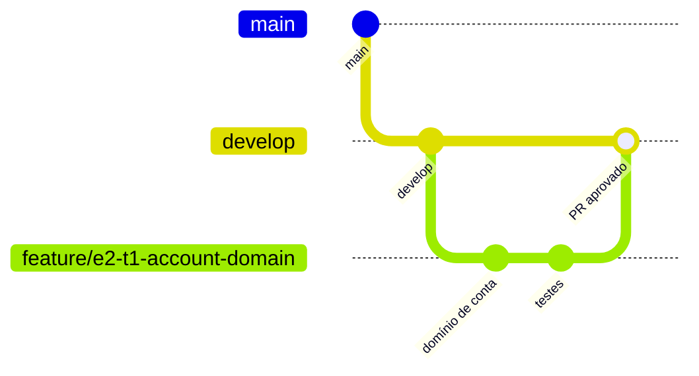

# 💰 Gerenciamento de Finanças

Sistema de gerenciamento de finanças pessoais construído em **microsserviços**, com arquitetura em camadas (**domain / application / infra**) e **circuit breaker** para manter o sistema funcionando mesmo quando uma dependência falha.

O usuário cadastra contas, lança receitas e despesas, anexa comprovantes, acompanha orçamentos e recebe categorização automática e insights gerados por IA (Claude).

> 📚 Documentação detalhada na pasta [`docs/`](docs/README.md).

---

## Sumário

- [Stack](#stack)
- [Microsserviços](#microsserviços)
- [Estrutura do repositório](#estrutura-do-repositório)
- [Pré-requisitos](#pré-requisitos)
- [Configuração](#configuração)
- [Levantando o ambiente](#levantando-o-ambiente)
- [Executando os serviços](#executando-os-serviços)
- [Executando os testes](#executando-os-testes)
- [Fluxo de trabalho](#fluxo-de-trabalho)
- [Observabilidade](#observabilidade)
- [Portas e acessos](#portas-e-acessos)
- [Problemas comuns](#problemas-comuns)

---

## Stack

| Categoria | Tecnologia |
|---|---|
| Linguagem | Java 25 |
| Framework | Spring Boot 4.1.1 |
| Build | Maven (multi-módulo) |
| Configuração | YAML (`application.yml`) |
| Banco de dados | MongoDB (IDs em UUID) |
| Object storage | RustFS (compatível com API S3) |
| Mensageria | RabbitMQ |
| IA | Claude (Anthropic) via Spring AI |
| Resiliência | Resilience4j (Circuit Breaker, Retry, Time Limiter) |
| Containers | Docker / Docker Compose |
| Testes | JUnit 5, Mockito, Testcontainers |
| Observabilidade | OpenTelemetry, Jaeger, Prometheus, Grafana |

---

## Microsserviços

| Serviço | Porta | Responsabilidade |
|---|---|---|
| `api-gateway` | 8080 | Porta de entrada única, autenticação e roteamento |
| `conta-service` | 8081 | Contas, carteiras e saldo |
| `transacao-service` | 8082 | Receitas e despesas |
| `orcamento-service` | 8083 | Orçamentos, metas e alertas |
| `documento-service` | 8084 | Comprovantes e notas fiscais (RustFS) |
| `assistente-ia-service` | 8085 | Categorização e insights com Claude |
| `notificacao-service` | 8086 | E-mail e push |

---

## Estrutura do repositório

Monorepo: todos os microsserviços em um único repositório Git, cada um como módulo Maven.

```
finance-api/
├── pom.xml                  ← POM pai e agregador (todos os módulos)
├── mvnw / mvnw.cmd / .mvn/  ← Maven Wrapper
├── README.md
├── CLAUDE.md                ← regras para o Claude trabalhar no projeto
├── .github/                 ← workflows de CI e template de pull request
├── docs/                    ← documentação
├── deploy/                  ← Docker Compose, .env.example e configs da infraestrutura
├── shared/                  ← contratos de eventos e utilitários comuns
├── api-gateway/
├── conta-service/
├── transacao-service/
├── orcamento-service/
├── documento-service/
├── assistente-ia-service/
└── notificacao-service/
```

Cada serviço segue as camadas `domain` / `application` / `infra`. Detalhes em [`docs/estrutura-de-pastas.md`](docs/estrutura-de-pastas.md).

---

## Pré-requisitos

| Ferramenta | Versão mínima | Verificar com |
|---|---|---|
| JDK | 25 | `java -version` |
| Maven | 3.9+ (ou use o `./mvnw` do projeto) | `mvn -v` |
| Docker | 24+ | `docker -v` |
| Docker Compose | v2 | `docker compose version` |
| Chave da API Anthropic | — | [console.anthropic.com](https://console.anthropic.com) |

> O Docker precisa estar **rodando** também para os testes de integração (Testcontainers).

---

## Configuração

### 1. Clonar o repositório

```bash
git clone <url-do-repositorio> finance-api
cd finance-api
```

### 2. Criar o arquivo de variáveis de ambiente

```bash
cp deploy/.env.example deploy/.env
```

Edite `deploy/.env`:

```dotenv
# IA
ANTHROPIC_API_KEY=sk-ant-xxxxxxxx

# MongoDB
MONGO_ROOT_USER=financas
MONGO_ROOT_PASSWORD=financas

# RabbitMQ
RABBITMQ_USER=financas
RABBITMQ_PASSWORD=financas

# RustFS (S3)
RUSTFS_ACCESS_KEY=rustfsadmin
RUSTFS_SECRET_KEY=rustfsadmin
RUSTFS_BUCKET_RECEIPTS=receipts

# Observabilidade
OTEL_EXPORTER_OTLP_ENDPOINT=http://localhost:4318
```

> ⚠️ Nunca faça commit do `.env`. Ele já está no `.gitignore`.

### 3. Perfis do Spring

| Perfil | Uso |
|---|---|
| `local` | Desenvolvimento na máquina, apontando para o Docker Compose |
| `test` | Testes automatizados (Testcontainers) |
| `prod` | Produção, com valores vindos de variáveis de ambiente/secrets |

Para ativar um perfil: `SPRING_PROFILES_ACTIVE=local`.

---

## Levantando o ambiente

### Opção A — Só a infraestrutura (para rodar os serviços pela IDE)

Sobe MongoDB, RabbitMQ, RustFS, OTel Collector, Jaeger, Prometheus e Grafana:

```bash
docker compose -f deploy/docker-compose.yml --env-file deploy/.env up -d
```

Confira se tudo está saudável:

```bash
docker compose -f deploy/docker-compose.yml ps -a
```

Todos os serviços devem aparecer como `healthy`, exceto o `rabbitmq-definitions`: ele só importa as exchanges do `deploy/rabbitmq/definitions.json` pela API do RabbitMQ e termina com `Exited (0)`. Por isso não use `up --wait`: o Compose trata esse container encerrado como falha e retorna erro, mesmo com tudo saudável.

**MongoDB em replica set.** O Mongo sobe como replica set de um nó (`rs0`), necessário para as transações da outbox. Na primeira subida o healthcheck inicia o replica set, então leva alguns segundos até ficar `healthy`. Para conectar:

| De onde | URI |
|---|---|
| Serviço rodando na máquina (IDE) | `mongodb://<usuario>:<senha>@localhost:27017/<banco>?authSource=admin` |
| Serviço rodando em container (`finance-net`) | `mongodb://<usuario>:<senha>@mongo:27017/<banco>?authSource=admin&directConnection=true` |

O membro do replica set está registrado como `localhost:27017`; por isso, dentro da rede do Docker, é preciso `directConnection=true`.

### Opção B — Tudo em containers (infra + microsserviços)

```bash
# 1. Gera os jars
./mvnw clean package -DskipTests

# 2. Sobe infra + serviços
docker compose -f deploy/docker-compose.yml -f deploy/docker-compose.services.yml \
  --env-file deploy/.env up -d --build
```

### Derrubando o ambiente

```bash
# Para os containers mantendo os dados
docker compose -f deploy/docker-compose.yml down

# Para e APAGA os volumes (banco, filas e arquivos)
docker compose -f deploy/docker-compose.yml down -v
```

---

## Executando os serviços

Com a infraestrutura de pé (Opção A):

```bash
# Compilar tudo uma vez
./mvnw clean install -DskipTests

# Rodar um serviço específico
./mvnw -pl conta-service spring-boot:run -Dspring-boot.run.profiles=local
./mvnw -pl transacao-service spring-boot:run -Dspring-boot.run.profiles=local
```

Ordem recomendada de subida:

1. `conta-service`
2. `transacao-service`, `orcamento-service`, `documento-service`
3. `assistente-ia-service`, `notificacao-service`
4. `api-gateway`

> Graças ao circuit breaker, a ordem não é obrigatória: se um serviço ainda não subiu, os outros usam o fallback e se recuperam sozinhos quando ele ficar disponível.

### Testando rapidamente

```bash
# Saúde do serviço
curl http://localhost:8082/actuator/health

# Criar uma conta
curl -X POST http://localhost:8080/api/accounts \
  -H "Content-Type: application/json" \
  -d '{"name": "Conta Corrente", "initialBalance": 1000.00, "currency": "BRL"}'

# Lançar uma despesa (use o id retornado acima)
curl -X POST http://localhost:8080/api/transactions \
  -H "Content-Type: application/json" \
  -d '{"accountId": "<uuid>", "type": "EXPENSE", "amount": 59.90, "description": "Mercado"}'
```

---

## Executando os testes

| Tipo | Sufixo da classe | Plugin Maven | Precisa de Docker? |
|---|---|---|---|
| Unitário (domain/application) | `*Test` | Surefire | Não |
| Integração (infra) | `*IT` | Failsafe | Sim (Testcontainers) |

```bash
# Só testes unitários (rápido)
./mvnw test

# Unitários + integração
./mvnw verify

# Só um serviço
./mvnw -pl transacao-service verify

# Só uma classe
./mvnw -pl transacao-service test -Dtest=RegisterTransactionServiceTest

# Só um teste de integração
./mvnw -pl transacao-service verify -Dit.test=TransactionMongoRepositoryAdapterIT

# Pular os testes de integração
./mvnw verify -DskipITs
```

Relatório de cobertura (JaCoCo), gerado após `verify`:

```
<servico>/target/site/jacoco/index.html
```

> Mais detalhes sobre a estratégia de testes em [`docs/etapas.md`](docs/etapas.md#etapa-8--testes).

### Hooks do Claude Code

Configurados em [`.claude/settings.json`](.claude/settings.json), com scripts bash em `.claude/hooks/` (sem Node, `jq` ou Python; no Windows usam o Git Bash):

| Hook | Quando roda | O que faz |
|---|---|---|
| `block-mvn.sh` | Antes de comandos de shell | Bloqueia `mvn`; o projeto usa sempre `./mvnw` |
| `protect-env.sh` | Antes de editar arquivos ou rodar comandos de shell | Bloqueia alterações em `.env` (o `.env.example` é liberado) |
| `protect-branches.sh` | Antes de `git commit` | Bloqueia commit direto em `main`, `develop` e `homol` (ver [Fluxo de trabalho](#fluxo-de-trabalho)) |
| `conventional-commits.sh` | Antes de criar branch e de `git commit` | Bloqueia nomes de branch e mensagens de commit fora do [padrão](#padrão-de-nomes) |
| `test-before-commit.sh` | Antes de `git commit` | Roda `./mvnw test` nos módulos alterados (todos, se mudou o `pom.xml` raiz ou `shared/`) e bloqueia o commit se algum teste falhar |

Os hooks valem para as ações do Claude. Commits feitos direto no terminal não passam por eles.

---

## Fluxo de trabalho

Durante as etapas de desenvolvimento, toda alteração segue **develop → branch → pull request → develop**:



1. Atualize a `develop` e crie a branch a partir dela:
   ```bash
   git switch develop
   git pull
   git switch -c feature/e2-t1-account-domain
   ```
2. Faça os commits na branch, com os testes passando.
3. Envie a branch e abra um pull request **para a `develop`**. O corpo já vem do [template](.github/pull_request_template.md): preencha a tarefa, o que mudou, como testar e o checklist.
4. Espere os checks da [integração contínua](#integração-contínua) ficarem verdes antes do merge.
5. Depois do merge, a branch pode ser apagada.

| Branch | Uso |
|---|---|
| `develop` | Integração do desenvolvimento; recebe código só por pull request |
| `homol` | Homologação; nunca recebe commit direto |
| `main` | Produção; nunca recebe commit direto |
| `<tipo>/<tarefa>-<descrição>` | Trabalho de uma tarefa, criada a partir da `develop` |

### Padrão de nomes

Branches e commits seguem o [Conventional Commits](https://www.conventionalcommits.org/pt-br/v1.0.0/). O hook `conventional-commits.sh` bloqueia nomes fora do padrão.

| | Formato | Tipos | Exemplo |
|---|---|---|---|
| Branch | `<tipo>/<tarefa>-<descrição>` | `feature`, `refactor`, `bugfix`, `hotfix`, `release`, `chore` | `feature/e2-t1-account-domain` |
| Commit | `<tipo>: <descrição>` | `feat`, `fix`, `docs`, `style`, `refactor`, `perf`, `test`, `chore` | `feat: add account domain` |

- `<tarefa>` é o código da tarefa no quadro (`e2-t1`); a descrição da branch é curta, em inglês, minúscula e em kebab-case.
- No commit, o espaço depois dos dois-pontos é obrigatório, como no Conventional Commits. Escopo e `!` de breaking change são aceitos: `fix(conta): handle missing account`, `refactor!: rename ports`.
- Só a primeira linha do commit é validada; o corpo é livre.

### Integração contínua

Todo pull request para a `develop` roda dois workflows do GitHub Actions, em `.github/workflows/`:

| Workflow | Check | O que faz |
|---|---|---|
| [`ci.yml`](.github/workflows/ci.yml) | `Build e testes (./mvnw verify)` | Java 25 (Temurin) com cache do Maven e `./mvnw -B verify` pela raiz: unitários, integração (`*IT`) com Testcontainers e a meta de 80% do JaCoCo. Se falhar, os relatórios ficam como artefato `test-reports` por 7 dias. |
| [`pr-title.yml`](.github/workflows/pr-title.yml) | `Título no padrão <tipo>: <descrição>` | Valida o título do PR com a mesma regra das mensagens de commit. Roda de novo quando o título é editado. |

Os testes não chamam a API do Claude (o `ChatModel` é sempre mockado), então o CI não precisa de nenhum segredo.

**Proteção da `develop` (configurada no GitHub pelo dono do repositório):** em *Settings → Branches → Add branch ruleset* (ou *branch protection rule*) para a `develop`, marque *Require a pull request before merging* e *Require status checks to pass*, e adicione os dois checks acima. Assim nenhum merge acontece com o build quebrado ou com o título fora do padrão, nem fora do Claude.

---

## Observabilidade

| Ferramenta | URL | Para quê |
|---|---|---|
| Jaeger | http://localhost:16686 | Ver o caminho de cada requisição (traces) |
| Prometheus | http://localhost:9090 | Consultar métricas |
| Grafana | http://localhost:3000 (admin/admin) | Dashboards e alertas |

Métricas úteis no Prometheus:

```promql
# Estado dos circuit breakers (1 = estado atual)
resilience4j_circuitbreaker_state

# Taxa de falha por circuito
resilience4j_circuitbreaker_failure_rate

# Latência das requisições HTTP
http_server_requests_seconds_bucket
```

---

## Portas e acessos

| Componente | Porta | Credenciais (local) |
|---|---|---|
| API Gateway | 8080 | — |
| MongoDB | 27017 | `financas` / `financas` |
| RabbitMQ (AMQP) | 5672 | `financas` / `financas` |
| RabbitMQ (painel) | 15672 | `financas` / `financas` |
| RustFS (API S3) | 9000 | `rustfsadmin` / `rustfsadmin` |
| RustFS (console) | 9001 | `rustfsadmin` / `rustfsadmin` |
| OTel Collector | 4317 (gRPC) / 4318 (HTTP) | — |
| Jaeger | 16686 | — |
| Prometheus | 9090 | — |
| Grafana | 3000 | `admin` / `admin` |

---

## Problemas comuns

| Sintoma | Causa provável | Solução |
|---|---|---|
| Testes `*IT` falham com "Could not find a valid Docker environment" | Docker parado | Inicie o Docker e rode de novo |
| `Unsupported class file major version` | JDK diferente do 25 | Ajuste `JAVA_HOME` para o JDK 25 |
| Transações salvas como `UNCLASSIFIED` | Circuit breaker da IA aberto ou `ANTHROPIC_API_KEY` inválida | Verifique a chave e `/actuator/circuitbreakers` |
| Erro 503 ao lançar transação | `conta-service` fora do ar (circuito aberto) | Suba o `conta-service`; o circuito fecha sozinho |
| UUID aparece como binário estranho no Mongo | Representação de UUID não configurada | Confira `representation.uuid: standard` no YAML |
| Porta já em uso | Outro processo usando a porta | `docker compose down` ou altere a porta no `.env` |

---

## Documentação

| Documento | Conteúdo |
|---|---|
| [Visão geral da documentação](docs/README.md) | Índice e por onde começar |
| [Arquitetura](docs/arquitetura.md) | Microsserviços, camadas, circuit breaker, mensageria, observabilidade |
| [Estrutura de pastas](docs/estrutura-de-pastas.md) | O que vai em cada pasta e pacote |
| [Fluxos](docs/fluxos.md) | Passo a passo dos principais fluxos com diagramas |
| [Etapas](docs/etapas.md) | Ordem de construção do projeto |
| [Conceitos](docs/conceitos.md) | Explicação simples e glossário |
