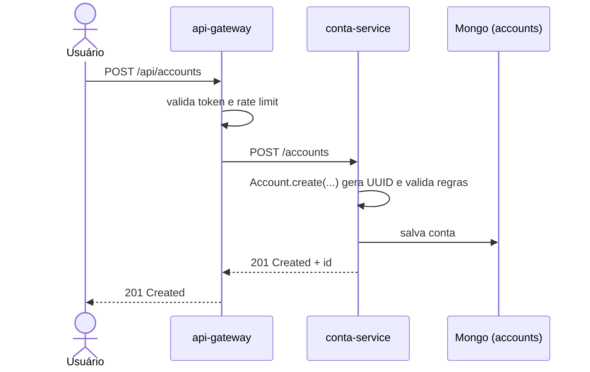
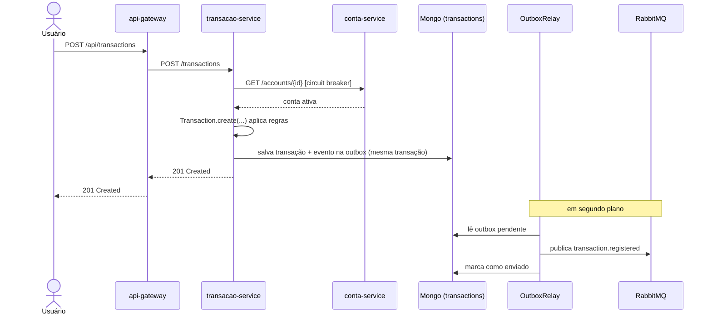
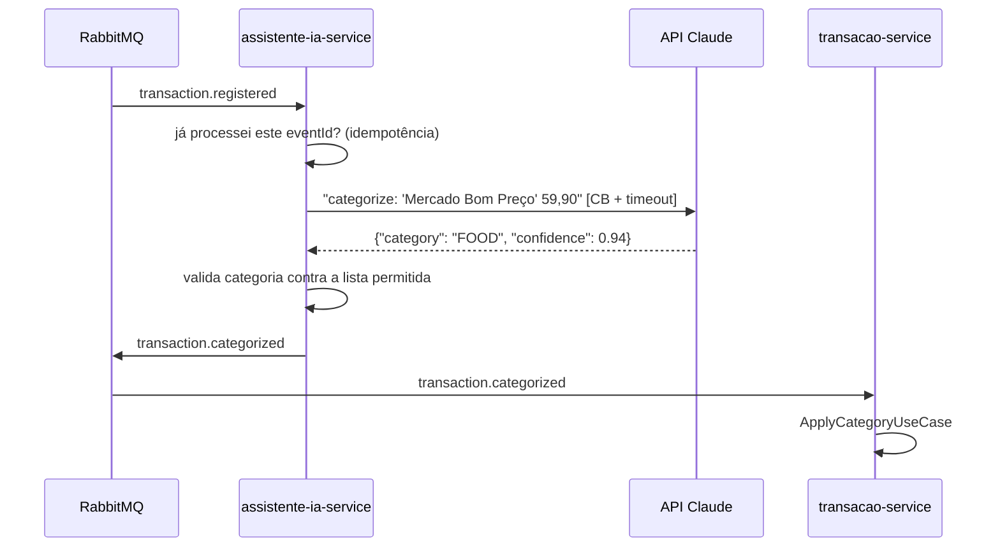
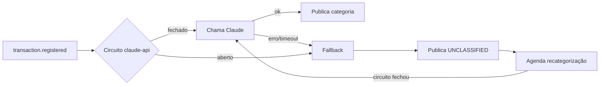
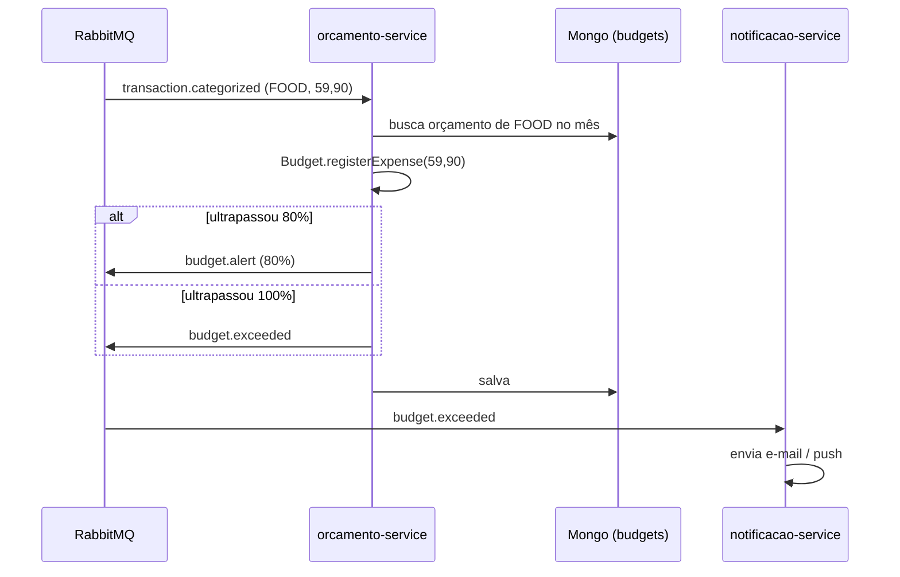
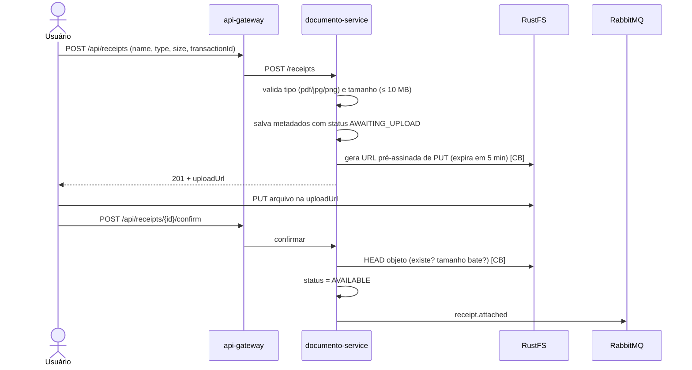
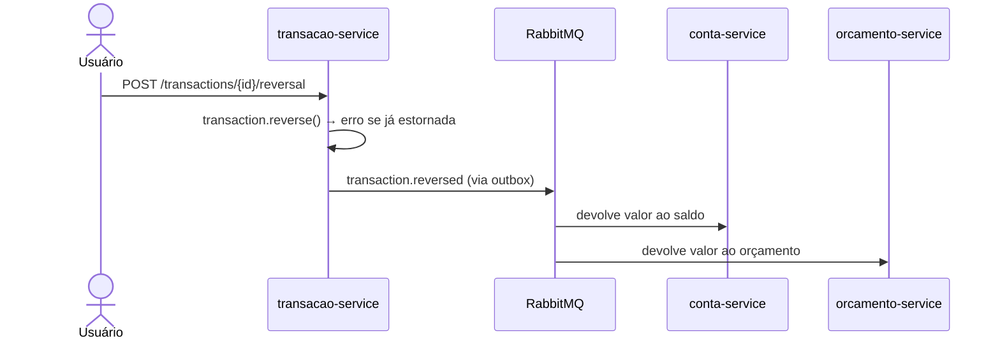
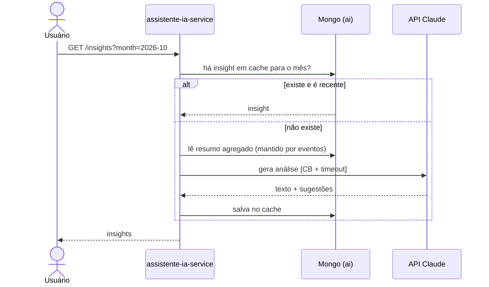
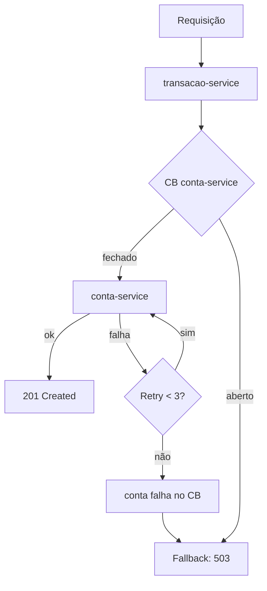

# 🔄 Fluxos

Passo a passo do que acontece no sistema em cada ação importante, incluindo os cenários de falha.

## Sumário

1. [Cadastrar conta](#1-cadastrar-conta)
2. [Registrar transação](#2-registrar-transação)
3. [Categorização automática com IA](#3-categorização-automática-com-ia)
4. [Atualização de orçamento e alerta](#4-atualização-de-orçamento-e-alerta)
5. [Anexar comprovante](#5-anexar-comprovante)
6. [Estornar transação](#6-estornar-transação)
7. [Gerar insights do mês](#7-gerar-insights-do-mês)
8. [Cenários de falha](#8-cenários-de-falha)
9. [Reprocessamento de mensagens (DLQ)](#9-reprocessamento-de-mensagens-dlq)

---

## 1. Cadastrar conta

**Regras:** nome obrigatório, saldo inicial não negativo, moeda suportada (BRL, USD, EUR).

---

## 2. Registrar transação

Fluxo central do sistema.

**Quem reage ao evento `transaction.registered`:**

| Consumidor | O que faz |
|---|---|
| `conta-service` | Atualiza o saldo da conta |
| `assistente-ia-service` | Categoriza a transação (fluxo 3) |
| `orcamento-service` | Soma ao orçamento do mês (fluxo 4) |

**Etapas em linguagem simples:**

1. O usuário envia a despesa.
2. O sistema confere se a conta existe.
3. A despesa é salva junto com um "recado" para os outros serviços.
4. O usuário recebe a confirmação na hora.
5. Logo depois, o recado é entregue: o saldo é atualizado, a IA categoriza e o orçamento é recalculado.

---

## 3. Categorização automática com IA

**Se o Claude estiver fora ou lento:**

A transação **nunca fica bloqueada** por causa da IA.

---

## 4. Atualização de orçamento e alerta

**Regras do domínio `Budget`:**
- Alerta em 80% e 100% do limite, **uma vez por mês por limite**, sem repetir avisos.
- Estorno devolve o valor ao orçamento.

---

## 5. Anexar comprovante

Upload direto para o RustFS com **URL pré-assinada**: o arquivo não passa pelo serviço.

**Download:** `GET /api/receipts/{id}` devolve uma URL pré-assinada de GET válida por 5 minutos.

**Limpeza:** uma tarefa agendada apaga metadados que ficaram em `AWAITING_UPLOAD` por mais de 24h.

---

## 6. Estornar transação

Transações **nunca são apagadas**, só estornadas. O histórico financeiro fica íntegro.

---

## 7. Gerar insights do mês

- O `assistente-ia-service` mantém sua **própria cópia resumida** dos gastos (por categoria e mês), atualizada pelos eventos. Assim ele não precisa chamar o `transacao-service`.
- Se o circuito estiver aberto, devolve o último insight salvo, ou só os números agregados sem o texto da IA.

---

## 8. Cenários de falha

| Cenário | O que o usuário percebe | O que o sistema faz | Como se recupera |
|---|---|---|---|
| `conta-service` fora do ar | Erro 503 ao lançar transação: "tente novamente em instantes" | Retry 3x, depois o circuito abre e passa a falhar rápido | Circuito testa de novo após 30s e fecha sozinho |
| API do Claude fora ou lenta | Transação aparece como "Não classificada" | Fallback + recategorização agendada | Quando o circuito fecha, as pendentes são recategorizadas |
| RustFS fora do ar | Não consegue anexar comprovante agora; a transação funciona | Circuito `rustfs` abre; erro 503 só no anexo | Usuário tenta de novo depois |
| RabbitMQ fora do ar | Nada: a transação é salva normalmente | Eventos acumulam na outbox | Relay publica tudo quando o RabbitMQ volta |
| Consumidor com erro | Saldo ou orçamento atrasado | Retry da mensagem; após 5 tentativas vai para a DLQ | Correção + reprocessamento da DLQ (seção 9) |
| Mensagem duplicada | Nada | Consumidor reconhece o `eventId` e ignora | — |

### Visualizando a falha

---

## 9. Reprocessamento de mensagens (DLQ)

1. Alerta no Grafana: "DLQ com mensagens".
2. Ver a mensagem no painel do RabbitMQ (http://localhost:15672) e o trace no Jaeger pelo `traceparent`.
3. Corrigir a causa (bug, dado inválido etc.).
4. Mover a mensagem de volta para a fila original (shovel ou endpoint administrativo `POST /admin/dlq/{queue}/reprocess`).
5. Como os consumidores são idempotentes, reprocessar é seguro.
